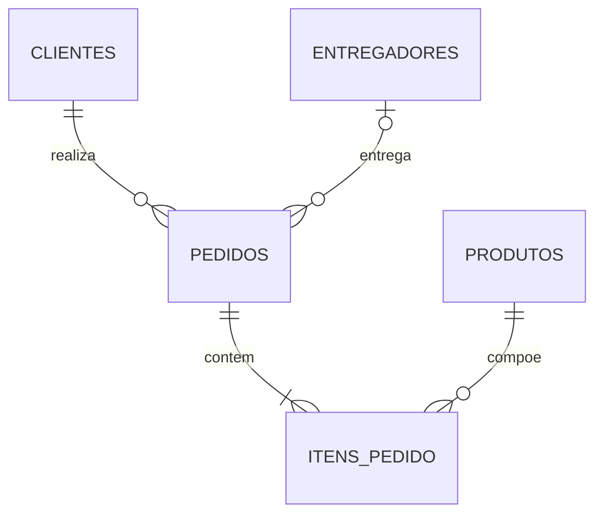

Aplique os arquivos SQL uma vez, em ordem, antes do seed. Em um banco existente, execute apenas as migrações pendentes.

1. [001-inicial.sql](001-inicial.sql) cria as seis tabelas InnoDB.
2. [002-entregadores.sql](002-entregadores.sql) adiciona veículo e disponibilidade.
3. [003-catalogo.sql](003-catalogo.sql) explicita a moeda de origem e permite arquivar produtos vinculados a vendas passadas. Os produtos existentes mantêm o preço de venda em reais.

Chaves estrangeiras:

- `pedidos.cliente_id` referencia `clientes.id`.
- `pedidos.entregador_id` referencia `entregadores.id` e aceita `NULL` enquanto não houver entregador atribuído.
- `itens_pedido.pedido_id` referencia `pedidos.id`; os itens são removidos junto com o pedido.
- `itens_pedido.produto_id` referencia `produtos.id`.

`usuarios`, `clientes`, `produtos`, `entregadores` e `pedidos` possuem handlers IPC. O checkout grava pedido e itens, atualiza estoque e reserva o entregador escolhido na mesma transação.
