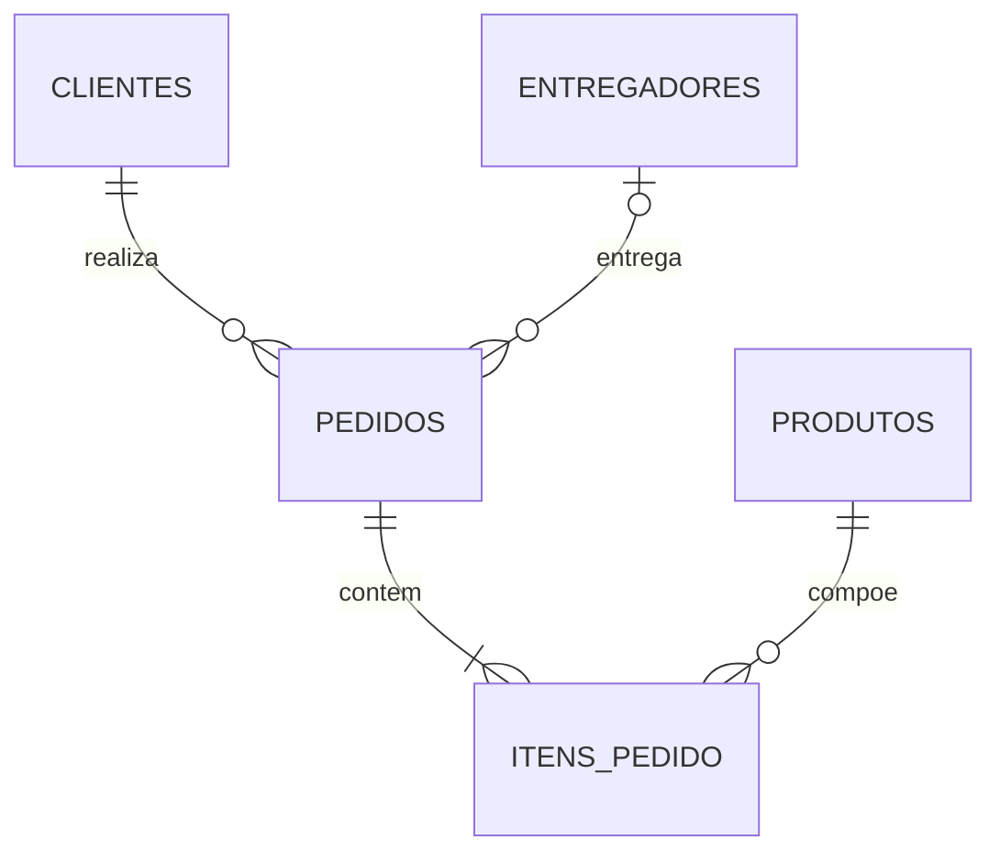

As migrations MySQL ficam ordenadas pelo prefixo numérico. `001-inicial.sql` cria as seis tabelas base; aplique-a uma vez no banco da equipe antes de executar o seed. O checkout também exige `002-entregadores.sql`; consulte [configuração do checkout](002-entregadores.md).

- Aplique `001-inicial.sql` uma vez para criar as seis tabelas base.
- Aplique `002-entregadores.sql` para adicionar veículo e disponibilidade ao cadastro.

Chaves estrangeiras:

- `pedidos.cliente_id` referencia `clientes.id`.
- `pedidos.entregador_id` referencia `entregadores.id` e aceita `NULL` enquanto não houver entregador atribuído.
- `itens_pedido.pedido_id` referencia `pedidos.id`; os itens são removidos junto com o pedido.
- `itens_pedido.produto_id` referencia `produtos.id`.

`usuarios`, `clientes`, `produtos`, `entregadores` e `pedidos` possuem handlers IPC. O checkout grava pedido e itens, atualiza estoque e reserva o entregador escolhido na mesma transação.
